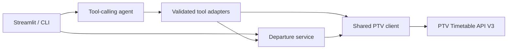

# Hopwise

**A Melbourne train assistant built with Python, the PTV Timetable API and OpenAI tool calling.**

Hopwise answers questions such as **"What are the next trains from Richmond,
and are there any disruptions?"** It resolves the station, retrieves upcoming
services and their associated notices, then presents the evidence in a Streamlit
interface or a terminal answer.

This is an independent AI engineering portfolio project focused on reliable
API integration, bounded tool calling and reproducible evaluation. The transport
logic also works without an LLM.

[Architecture](docs/architecture.md) | [Evaluation and results](docs/evaluation.md) | [Golden dataset](evals/dataset.json)

## Current status

**Local project snapshot: 25 November 2026.**

| Area | Evidence |
| --- | --- |
| Automated verification | **703 offline tests passed** in the latest local full-suite run |
| Agent evaluation | **14 single-turn golden cases**, dataset **v0.3.0**, with a fully reviewed real-LLM baseline |
| Conversation continuity | Station/count follow-ups implemented, tested offline and manually checked through tool executions |
| Multi-turn evaluation | Five scripted offline scenarios covering eight turns, including reset and session-isolation checks |
| Destination-query service | Bounded candidate/pattern retrieval, deterministic stop verification and explicit unknown outcomes in Python; agent/UI integration remains a future increment |
| Latest passenger presentation | Deterministic minute rounding implemented; exact timing diagnostics retained; newer model-run review pending |

This is a working local prototype. The single-turn benchmark does not establish
multi-turn answer quality or production readiness.

## What it does

- Searches metropolitan Melbourne train stations and preserves ambiguous matches.
- Shows upcoming departures, destinations, platforms and Melbourne local times.
- Keeps scheduled times and real-time estimates distinct, including missing estimates.
- Uses deterministic minute-based passenger wording while retaining exact delay diagnostics.
- Links disruption notices using PTV's explicit `disruption_ids`, keeping broader route context separate.
- Explains notice relevance conservatively, distinguishing stated operating hours from confirmed impact on a train.
- Answers natural-language questions through two validated, allowlisted tools.
- Supports session-scoped station/count follow-ups with fresh retrieval each turn.
- Provides optional sanitized execution traces and a fourteen-case evaluation dataset.

**Stack:** Python 3.11 | uv | HTTPX | Pydantic | OpenAI Responses API | Streamlit | pytest

## Engineering approach

The LLM selects tools and writes the answer. Python validates arguments,
calculates signed estimate-versus-schedule differences and matches disruption IDs.
The same API client and service layer support the UI, CLI, agent and evaluations.

The only tools are `search_stations(query)` and
`get_departures_with_disruptions(stop_id, limit)`. Stop IDs must come from a search
in the current turn; result limits are validated from 1 to 10. The orchestration
allows at most five sequential tool-call rounds and returns controlled errors.



Streamlit remembers only the active station name and last departure count for
follow-ups. Each turn validates the station again before using a stop ID and
retrieves fresh departures. Previous answers and transport records are not fed
back as current evidence. No LangChain or multi-agent framework is required.

## Quick start

You need Python 3.11 and [uv](https://docs.astral.sh/uv/getting-started/installation/).
Run these commands from the project root:

```sh
git clone https://github.com/dayan83/hopwise.git
cd hopwise
uv sync --locked
```

### Explore without API keys

```sh
uv run --offline --frozen pytest -q
```

Tests use mocked HTTP responses and scripted LLM responses. They exercise the
PTV client, structured models, matching service, agent orchestration, Streamlit
views and evaluation pipeline without calling PTV or OpenAI.

For a focused look at conversation continuity and fixed PTV fixtures:

```sh
uv run --offline --frozen pytest -q tests/test_conversation.py tests/test_fixture_transport.py
```

### Configure the application

Copy [.env.example](.env.example) to `.env` and replace the placeholders.
In PowerShell:

```powershell
Copy-Item .env.example .env
```

On macOS/Linux, use `cp .env.example .env`.

| Variable | Used for |
| --- | --- |
| `PTV_DEV_ID` | PTV developer ID |
| `PTV_API_KEY` | PTV request signing |
| `PTV_BASE_URL` | `https://timetableapi.ptv.vic.gov.au` |
| `OPENAI_API_KEY` | AI assistant and real-LLM evaluations only |
| `OPENAI_MODEL` | A model available to your account that supports Responses function calling |

The station/departure interface needs only PTV configuration. The AI assistant
also needs OpenAI configuration. Existing environment variables take precedence
over `.env`. Credentials stay in local configuration; `.env` is Git-ignored.

### Run the Streamlit app

```sh
uv run streamlit run streamlit_app.py
```

Search for a station, select a match and view its departure board. Linked notices
expand for detail. Use **Refresh departures** for a new PTV request, or ask a
question in the **Hopwise AI Assistant** section. Follow with **"What about just
the next two?"** or **"And from Flinders Street instead?"** without repeating the
original question. **New conversation** clears chat and conversation preferences;
the separate manual station/departure controls retain their own state.

For example:

| Turn | Question | Retrieval behaviour |
| --- | --- | --- |
| 1 | What are the next trains from Richmond? | Resolve Richmond and request up to five fresh departures |
| 2 | What about just the next two? | Validate Richmond again and request up to two fresh departures |
| 3 | And from Flinders Street instead? | Resolve Flinders Street, keeping the count of two, and fetch fresh departures |

Only station/count preferences persist. Ambiguous searches request clarification,
and previous departure records are never used as current results. This is basic
continuity, not full conversation-history memory.

Python supplies deterministic passenger wording: 129 seconds becomes **"About 2 minutes
late (estimated)"**, while 30 seconds early becomes **"Slightly early (estimated)"**.
Differences of at least a minute round to the nearest whole minute, with half-minutes
rounded up in magnitude. Smaller late differences receive neutral wording without
an on-time guarantee. Exact seconds remain available in diagnostic traces; scheduled
and estimated timestamps stay separately labelled.

### Ask from the terminal

```sh
uv run python ask_hopwise.py "What are the next trains from Richmond, and are there any disruptions?"
```

Add `--trace` to inspect validated tool arguments, execution order and sanitized
results. The answer is printed to stdout; the JSON trace goes to stderr.
The terminal command is single-turn; Streamlit manages conversation state
automatically, while Python callers can opt in with `ConversationState`.

These application commands use live PTV data; AI questions also call OpenAI
and incur the API usage associated with your account. Tests do neither.

## Evaluation

The versioned [golden dataset](evals/dataset.json), v0.3.0, contains fourteen manually authored
scenarios: normal departures, unknown and ambiguous stations, explicit result
counts, early/late estimates, missing estimates, empty departures and a morning
service associated with a late-night notice. Robustness cases add a PTV API failure,
unresolved disruption details, mixed early/late/missing estimates, an untrusted
instruction in a notice, and directly associated versus contextual notices.

| Activity | LLM | PTV data | Purpose |
| --- | --- | --- | --- |
| `uv run --offline --frozen pytest -q` | Scripted | Mocked/fixture-backed | Verify implementation offline |
| `uv run --offline --frozen python -m evals.multiturn --all` | Scripted | Fixed fixtures | Check five conversation scenarios and per-turn retrieval |
| `uv run python -m evals.multiturn --real-llm --all` | Real, explicit opt-in | Fixed fixtures | Evaluate follow-ups and refreshed answer facts; manual review required |
| `uv run python -m evals.run --all` | Real | Fixed fixtures | Observe model behaviour reproducibly |
| `uv run python -m evals.checks --run-dir evals/results/<run_id>` | None | Saved records | Score objective checks and aggregate manual labels |

Real-LLM evaluations are explicitly invoked and never run in CI. Fixture misses
fail closed, with no live PTV fallback. Results record model identifiers, prompt
and tool-schema hashes, token usage and request coverage.

### Reviewed baseline and latest run

The **24 November 2026 single-turn baseline** completed all 14 scenarios with no
execution errors or fixture misses. Its saved scores report:

| Measure | Reviewed baseline |
| --- | --- |
| Tool selection | 14/14 cases |
| Tool arguments | 26/26 checks |
| Execution | 96/96 checks |
| Structured source facts | 318/318 checks |
| Author manual review | 14/14 cases reviewed; mean 2.0/2 for factual accuracy, grounding and relevance |

These results describe a small synthetic dataset and project-author reviews.
Source-fact checks validate retrieved records, not every statement in the final
answer. They are not an independent assessment or a general accuracy estimate.

The **25 November passenger-wording run** also completed 14/14 cases with no
execution errors or fixture misses. Tool selection, argument, execution and source-fact
checks passed, while **11/14 cases passed all mechanical checks**. The three
failures are in the frozen exact-seconds wording contract: the early, late and
mixed-delay scenarios now use the deliberately changed passenger descriptions.
Manual review of this newer run is pending.

The original expectations and historical labels have been preserved. A separately
versioned wording contract is needed before comparing passenger-wording scores.
See the [evaluation guide](docs/evaluation.md) for the methodology, historical
nine-case results and compatibility details.

Provenance: reviewed run `20261124T053840Z_6e246e64de05`; newer passenger-wording run
`20261124T220639Z_31543e5b6a25`. Raw executions stay local under Git-ignored
`evals/results/`; the golden cases, fixtures and evaluation code are in the repository.

## Repository guide

| Path | Responsibility |
| --- | --- |
| [ptv.py](ptv.py) | Environment configuration, HMAC-SHA1 authentication and PTV requests |
| [models.py](models.py) | Validated departure, disruption and board models |
| [departure_service.py](departure_service.py) | ID-based matching, delay interpretation and relevance annotations |
| [departure_presentation.py](departure_presentation.py) | Passenger delay wording with documented minute rounding |
| [stopping_pattern_service.py](stopping_pattern_service.py) | Run stopping-pattern evidence with served / not served / unknown destination decisions |
| [destination_service.py](destination_service.py) | Bounded destination-aware departures with upcoming-time checks, pattern reuse and uncertainty metadata |
| [agent_tools.py](agent_tools.py) | Strict tool schemas, validation and service adapters |
| [agent.py](agent.py) | Bounded Responses API tool-calling loop |
| [agent_trace.py](agent_trace.py) | Optional sanitized execution snapshots |
| [conversation.py](conversation.py) | Caller-owned station/count preferences and fresh-turn instructions |
| [streamlit_app.py](streamlit_app.py) / [ask_hopwise.py](ask_hopwise.py) | UI and terminal entry points |
| [evals/](evals/) | Golden dataset, fixtures, transport, runner and offline checks |
| [tests/](tests/) | Offline unit, integration and UI tests |
| [docs/](docs/) | Architecture, evaluation methodology and historical baseline evidence |

The [test workflow](.github/workflows/tests.yml) installs locked dependencies and
runs pytest on Python 3.11 on Linux and Windows. API credentials are not required.

## Scope and limitations

Hopwise currently covers metropolitan trains and a limited upcoming-departure
sample. It does not plan journeys, send alerts or establish network-wide
disruption coverage.

Stopping-pattern verification and bounded destination-aware departure retrieval
are available in the Python service layer.
Destination-specific questions are not yet connected to the agent or UI.

For a manual live PTV contract check, run `uv run python smoke_stopping_pattern.py --live`
with the existing PTV `.env` configuration. This requires explicit opt-in and
does not use OpenAI. See the [diagnostic guide](docs/architecture.md#explicit-live-stopping-pattern-smoke-test)
for output, coverage warnings and exit codes.

An estimate is not an observed departure or a guarantee. A linked disruption
does not prove that a particular train is delayed or cancelled. Date and stop
annotations express limited structured evidence; they do not parse recurring
operating hours from free text.

The final answer is generated by an LLM and may still omit qualifications or
misstate evidence. Small fixture-backed evaluations and author reviews help
find regressions; they are not a claim of production readiness.

Hopwise is an independent project and is not affiliated with PTV. Transport data
comes from the [PTV Timetable API V3](https://timetableapi.ptv.vic.gov.au/swagger/ui/index).
