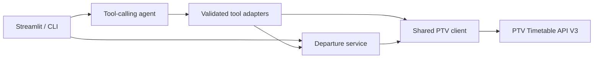

# Hopwise

**A Melbourne train assistant built with Python, the PTV Timetable API and OpenAI tool calling.**

Hopwise answers questions such as **"What are the next trains from Richmond,
and are there any disruptions?"** It resolves the station, retrieves upcoming
services and their associated notices, then presents the evidence in a Streamlit
interface or a terminal answer.

This is an independent portfolio and learning project. Its focus is reliable
API integration, a small tool-calling agent, and reproducible evaluation.
The transport logic also works without an LLM.

[Architecture](docs/architecture.md) | [Evaluation and results](docs/evaluation.md) | [Golden dataset](evals/dataset.json)

## What it does

- Searches metropolitan Melbourne train stations and preserves ambiguous matches.
- Shows upcoming departures, destinations, platforms and Melbourne local times.
- Keeps scheduled times and real-time estimates distinct, including missing estimates.
- Links disruption notices using PTV's explicit `disruption_ids`, keeping broader route context separate.
- Answers natural-language questions through two validated, allowlisted tools.
- Provides optional sanitized execution traces and a nine-case evaluation dataset.

**Stack:** Python 3.11 | uv | HTTPX | Pydantic | OpenAI Responses API | Streamlit | pytest

## Engineering approach

The LLM selects tools and writes the answer. Python validates arguments,
calculates signed estimate-versus-schedule differences and matches disruption IDs.
The same API client and service layer support the UI, CLI, agent and evaluations.



The agent has no conversation memory between questions. Each request must resolve
its own station before using its stop ID. No LangChain or multi-agent framework
is required.

## Quick start

You need Python 3.11 and [uv](https://docs.astral.sh/uv/getting-started/installation/).
Run these commands from the project root:

```sh
git clone https://github.com/dayan83/hopwise.git
cd hopwise
uv sync --locked
```

### Explore without API keys

```sh
uv run pytest -q
```

Tests use mocked HTTP responses and scripted LLM responses. They exercise the
PTV client, structured models, matching service, agent orchestration, Streamlit
views and evaluation pipeline without calling PTV or OpenAI.

For a focused look at the agent and fixed PTV fixtures:

```sh
uv run pytest -q tests/test_agent.py tests/test_fixture_transport.py
```

### Configure the application

Copy [.env.example](.env.example) to `.env` and replace the placeholders.
In PowerShell:

```powershell
Copy-Item .env.example .env
```

On macOS/Linux, use `cp .env.example .env`.

| Variable | Used for |
| --- | --- |
| `PTV_DEV_ID` | PTV developer ID |
| `PTV_API_KEY` | PTV request signing |
| `PTV_BASE_URL` | `https://timetableapi.ptv.vic.gov.au` |
| `OPENAI_API_KEY` | AI assistant and real-LLM evaluations only |
| `OPENAI_MODEL` | A model available to your account that supports Responses function calling |

The station/departure interface needs only PTV configuration. The AI assistant
also needs OpenAI configuration. Existing environment variables take precedence
over `.env`. Credentials stay in local configuration; `.env` is Git-ignored.

### Run the Streamlit app

```sh
uv run streamlit run streamlit_app.py
```

Search for a station, select a match and view its departure board. Linked notices
expand for detail. Use **Refresh departures** for a new PTV request, or ask a
complete question in the **Hopwise AI Assistant** section.

### Ask from the terminal

```sh
uv run python ask_hopwise.py "What are the next trains from Richmond, and are there any disruptions?"
```

Add `--trace` to inspect validated tool arguments, execution order and sanitized
results. The answer is printed to stdout; the JSON trace goes to stderr.

These application commands use live PTV data; AI questions also call OpenAI
and incur the API usage associated with your account. Tests do neither.

## Evaluation

The versioned [golden dataset](evals/dataset.json) contains nine manually authored
scenarios: normal departures, unknown and ambiguous stations, explicit result
counts, early/late estimates, missing estimates, empty departures and a morning
service associated with a late-night notice.

| Activity | LLM | PTV data | Purpose |
| --- | --- | --- | --- |
| `uv run pytest -q` | Scripted | Mocked/fixture-backed | Verify implementation offline |
| `uv run python -m evals.run --all` | Real | Fixed fixtures | Observe model behaviour reproducibly |
| `uv run python -m evals.checks --run-dir evals/results/<run_id>` | None | Saved records | Score objective checks and aggregate manual labels |

Real-LLM evaluations are explicitly invoked and never run in CI. Fixture misses
fail closed, with no live PTV fallback. Results record model identifiers, prompt
and tool-schema hashes, token usage and request coverage.

A reviewed nine-case **historical baseline** completed all cases without fixture
misses. It also revealed presentation weaknesses that led to explicit scheduled
time labels and estimated-time-first wording. The [evaluation guide](docs/evaluation.md)
reports the results, limitations and review process; completion is kept separate
from answer correctness.

## Repository guide

| Path | Responsibility |
| --- | --- |
| [ptv.py](ptv.py) | Environment configuration, HMAC-SHA1 authentication and PTV requests |
| [models.py](models.py) | Validated departure, disruption and board models |
| [departure_service.py](departure_service.py) | ID-based matching, delay interpretation and relevance annotations |
| [agent_tools.py](agent_tools.py) | Strict tool schemas, validation and service adapters |
| [agent.py](agent.py) | Bounded Responses API tool-calling loop |
| [agent_trace.py](agent_trace.py) | Optional sanitized execution snapshots |
| [streamlit_app.py](streamlit_app.py) / [ask_hopwise.py](ask_hopwise.py) | UI and terminal entry points |
| [evals/](evals/) | Golden dataset, fixtures, transport, runner and offline checks |
| [tests/](tests/) | Offline unit, integration and UI tests |
| [docs/](docs/) | Architecture, evaluation methodology and historical baseline evidence |

The [test workflow](.github/workflows/tests.yml) installs locked dependencies and
runs pytest on Python 3.11 on Linux and Windows. API credentials are not required.

## Scope and limitations

Hopwise currently covers metropolitan trains and a limited upcoming-departure
sample. It does not plan journeys, send alerts or establish network-wide
disruption coverage.

An estimate is not an observed departure or a guarantee. A linked disruption
does not prove that a particular train is delayed or cancelled. Date and stop
annotations express limited structured evidence; they do not parse recurring
operating hours from free text.

The final answer is generated by an LLM and may still omit qualifications or
misstate evidence. Small fixture-backed evaluations and author reviews help
find regressions; they are not a claim of production readiness.

Hopwise is an independent project and is not affiliated with PTV. Transport data
comes from the [PTV Timetable API V3](https://timetableapi.ptv.vic.gov.au/swagger/ui/index).
